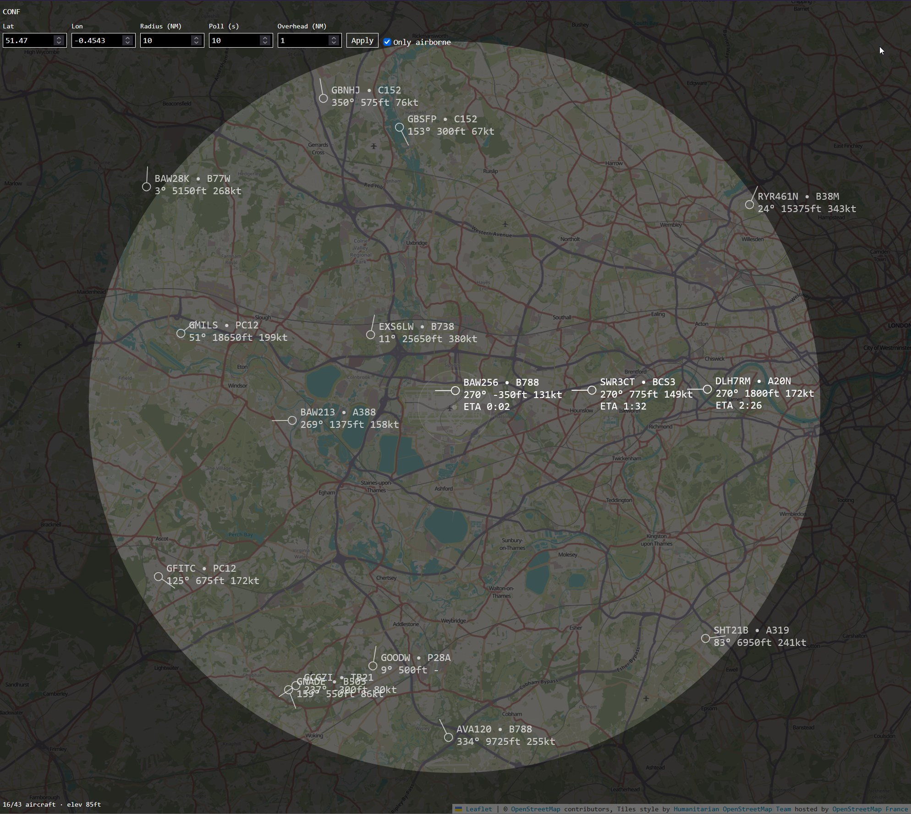

# Inbound aircraft

Live radar of aircraft around a point, flagging which ones will fly overhead and when.



- Polls [adsb.lol](https://adsb.lol) (proxied through `/api/aircraft`, no CORS upstream) for traffic within a radius.
- Projects each plane's current track in a straight line; planes passing within the overhead tolerance get an ETA, the rest are dimmed.
- Planes are dead-reckoned between polls. Zoom and pan the radar; off-screen planes show as edge markers.
- Location, radius, poll interval, and overhead tolerance live under **CONF**, saved in `localStorage`.

## Run

```bash
pnpm install
pnpm dev        # http://localhost:5173
pnpm test
pnpm typecheck
```

Production: `pnpm build && pnpm start`.
